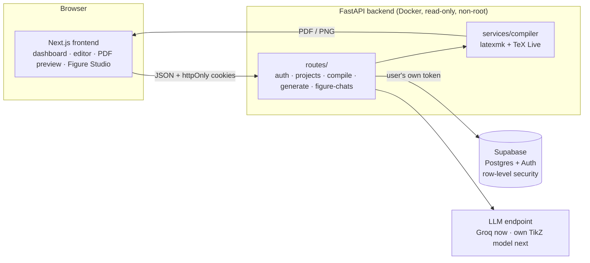
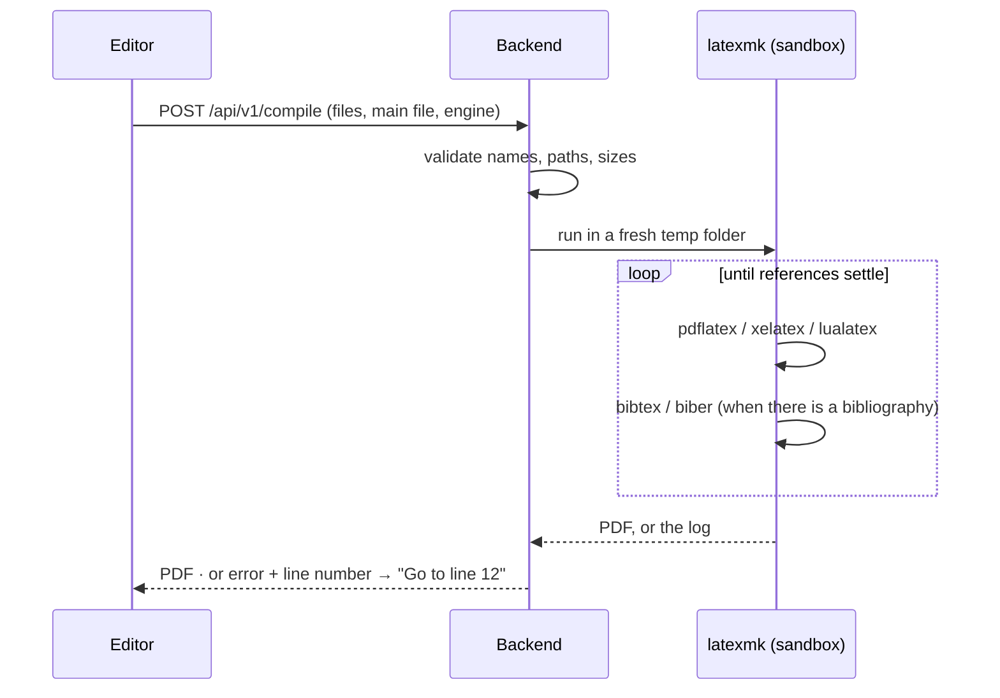
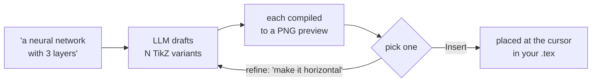

# TikZ Studio

**A LaTeX editor built around TikZ figures.** Write LaTeX, compile it to PDF in a sandboxed backend, and describe a figure in plain words to get several TikZ versions back. Pick one, refine it, and drop it into your document.

```
 Describe it ──▶ AI drafts TikZ variants ──▶ each one compiled & previewed ──▶ refine ──▶ insert into your .tex
```

## Highlights

| | |
|---|---|
| ✍️ **Editor** | CodeMirror LaTeX editor with syntax colours, snippets, bold/italic/underline shortcuts, search with match navigation, and a live **file outline** that follows your cursor |
| 🗂️ **Projects** | Dashboard with tags, archive, search, multi-select, a folder **file tree** (drag & drop, rename), `.zip` upload (e.g. an Overleaf download) and `.zip` download |
| 📄 **Real compilation** | `latexmk` runs **pdflatex, xelatex or lualatex** (picked per project) plus **bibtex/biber**, so citations and references resolve. Errors link straight to the failing line |
| 🎨 **Figure Studio** | Prompt → up to 10 TikZ variants, each compiled to a preview image. Refine one in conversation and insert it at your cursor. Chats are saved per user |
| ⚡ **Inline generation** | Type `/! a 3×3 matrix !/` in the editor and it is replaced with LaTeX |
| 💾 **Autosave** | Saved a second after you stop typing; saves run in order, so an older save never overwrites a newer one |
| 🔒 **Secure by design** | httpOnly cookie sessions, Postgres row-level security, a sandboxed read-only compiler container, rate limits and size limits |
| 🌗 **Polished UI** | Light & dark "Glacier" themes, keyboard shortcuts (`⌘↵` compile, `⌘\` sidebar, `/` search) |

## How it fits together



The browser never runs LaTeX and never sees a database key: every request goes through the backend, which talks to Supabase **with the signed-in user's own token**. Postgres row-level security keeps each user to their own rows, even if the backend has a bug.

## Compiling a project



Every compile gets a fresh temporary folder that is deleted afterwards. Shell escape is off, project files can't reach server secrets, and a timeout kills the whole process tree.

## Figure Studio



## Status

| Area | State |
|---|---|
| Editor, file tree, outline, search, autosave | ✅ Built |
| Accounts (email + password, email confirmation) | ✅ Built |
| Compilation: 3 engines, bibtex/biber, error jump-to-line | ✅ Built |
| Figure Studio: variants, previews, refine, saved chats | ✅ Built (on Groq `gpt-oss-120b`) |
| Our own fine-tuned TikZ model | 🚧 In progress: plugs in through `TIKZ_MODEL_URL`, no code changes needed |
| Sharing projects with other users | 🚧 Planned: the "Shared with you" view is ready, sharing isn't wired up yet |
| Integrations (Zotero, Git export) | 💡 Idea |

## Repository layout

```
TikZ_Studio/
├── compose.yaml              # runs frontend + backend
├── .env.example              # Supabase + model settings → copy to .env
├── supabase/schema.sql       # tables + row-level security (safe to re-run)
├── docs/architecture.md      # deeper design, security and hosting notes
└── src/
    ├── frontend/             # Next.js + React + CodeMirror
    │   ├── app/              #   page wiring, global theme
    │   ├── components/<name>/#   one folder per component: .tsx + .css
    │   └── lib/              #   API client, compile, autosave, zip, parsers
    └── backend/              # FastAPI
        ├── routes/           #   one file per API area
        ├── schemas/          #   request validation
        ├── services/         #   LaTeX compilation
        ├── utils/            #   config, errors, security, Supabase, auth
        └── tests/
```

## Run it

1. Create a Supabase project and run `supabase/schema.sql` in its SQL Editor.
2. Copy `.env.example` to `.env` and fill in `SUPABASE_URL`, `SUPABASE_KEY` and `GROQ_API_KEY`.
3. `docker compose up --build`, then open <http://localhost:3000>.

**Develop and test**

```bash
cd src/frontend && npm install && npm run dev       # UI on :3000, expects the backend on :4000
npm run lint && node lib/latexOutline.check.ts && node lib/projectImport.check.ts

cd src/backend && pip install -r requirements.txt pytest httpx && python -m pytest
```

See [docs/architecture.md](docs/architecture.md) for the full design.
